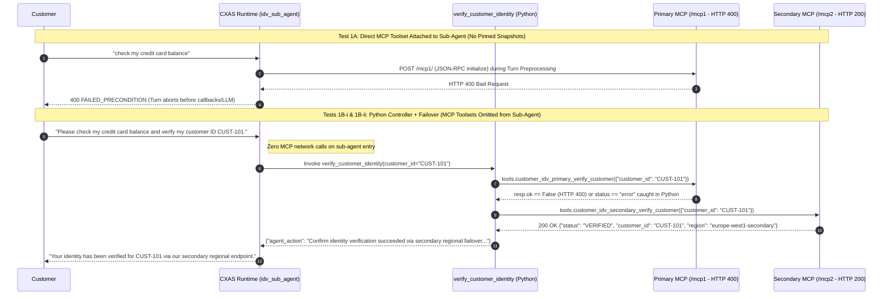

# End-to-End Verification Walkthrough — Live Test Matrix (`1A` through `2C`)

This document walks through the 10 verification tests in [`scripts/run_phase_a_mcp_and_a2a_baseline.py`](../../scripts/run_phase_a_mcp_and_a2a_baseline.py) and [`scripts/run_phase_b_vpcsc_a2a.py`](../../scripts/run_phase_b_vpcsc_a2a.py) using de-identified empirical outputs captured in an isolated Google Cloud project (`albion-gcp-project`, project number `123456789012`, organization `111222333444`, access policy `987654321098`) protected by an enforced VPC Service Controls perimeter (`albion_a2a_repro_perimeter`). All 10 test cases have been verified end-to-end against live Google Cloud infrastructure in release `v0.3.0` using the `cxas-scrapi` SDK (`>= 1.9.1`).

---

## Summary Matrix of All 10 Verification Cases

| Test ID | Scenario | Configuration Under Test | Observed HTTP / Runtime Result | Outcome |
| :--- | :--- | :--- | :--- | :--- |
| **Test 1A** | MCP Direct Toolset (Broken `/mcp1/`, No Snapshots) | `customer_idv` attached directly to `idv_sub_agent.toolsets[]` without `toolOverrides.snapshot`. | Outer `runSession` returns `400 FAILED_PRECONDITION`: `Failed to initialize MCP session for customer_idv ... HTTP status code 400 (Bad Request)`. | Reproduced entry-time crash |
| **Test 1B-i** | MCP Python Controller + Unpinned Primary Failover (`/mcp1/` -> `/mcp2/`) | `customer_idv_primary` (`/mcp1/`) and `customer_idv_secondary` (`/mcp2/`), omitted from `idv_sub_agent.toolsets[]`, invoked from `verify_customer_identity`. | Outer `runSession` returns `200 OK`: Primary `/mcp1/` (`resp.ok == False`) caught in Python; automatic failover to `/mcp2/` (`europe-west1-secondary`). | Verified Stage 1 failover |
| **Test 1B-ii** | MCP Python Controller + `toolOverrides` Update on Primary (`/mcp1/` -> `/mcp2/`) | `customer_idv_primary` (`/mcp1/`) updated with `toolOverrides` via `cxas-scrapi` (`Tools.update_tool`, with `snapshot_persisted_via_scrapi_update == True`) and invoked from `verify_customer_identity`. | Outer `runSession` returns `200 OK`: Primary `/mcp1/` failure caught in Python; automatic failover to `/mcp2/` (`europe-west1-secondary`). | Verified failover with `toolOverrides` |
| **Test 1B-iii** | MCP Python Controller Graceful Degradation (Total Outage) | Both `customer_idv_primary` and `customer_idv_secondary` pointed at broken `/mcp1/` (`400`) after the 180s Memstore toolset cache window. | Outer `runSession` returns `200 OK`: Both failures caught in Python (`idv_status = "UNAVAILABLE"`, `call_complete = "true"`); agent informs the customer a banking specialist will assist shortly. | Verified graceful degradation |
| **Test 2-0** | A2A Baseline (No VPC-SC Perimeter) | `personal-banking-a2a-caller` calls `mortgage-specialist-app` via native A2A tool before VPC-SC enforcement. | Outer `runSession` returns `200 OK`: Target Mortgage Specialist agent returns 5-year fixed rate (`4.15%`) and `10%` annual overpayment allowance. | Verified baseline A2A |
| **Test 2-pre** | A2A Inside Enforced VPC-SC Prior to `allowedOrigins` | Project placed inside `albion_a2a_repro_perimeter` before `https://ces.googleapis.com` is added to `SecuritySettings.endpointControlPolicy.allowedOrigins`. | Outbound A2A request to `https://ces.googleapis.com` is blocked by CXAS outbound endpoint control until `https://ces.googleapis.com` is added to `allowedOrigins`. | Verified `allowedOrigins` gate |
| **Test 2A** | A2A Inside Enforced VPC-SC Perimeter (No Egress Rules) | `https://ces.googleapis.com` added to `allowedOrigins`, but perimeter has zero egress rules for `service-123456789012@gcp-sa-ces.iam.gserviceaccount.com`. | Outer `runSession` returns `200 OK`; `Tool` trace span records `403 PERMISSION_DENIED` (`VPC_SERVICE_CONTROLS`), and Cloud Audit Logs record `egressViolations` (`RESOURCES_NOT_IN_SAME_SERVICE_PERIMETER`). | Reproduced VPC-SC A2A failure |
| **Test 2B-i** | A2A Inside VPC-SC + Custom SA Missing from Egress Rule | `serviceAccountAuthConfig` set to `a2a-custom-caller@...`, while VPC-SC egress rule only lists default `service-123456789012@gcp-sa-ces...`. | Outer `runSession` returns `200 OK`; `Tool` trace span records `403 PERMISSION_DENIED` (`VPC_SERVICE_CONTROLS`), and Cloud Audit Logs record `principalEmail: a2a-custom-caller@...` blocked by `RESOURCES_NOT_IN_SAME_SERVICE_PERIMETER`. | Verified custom SA identity mismatch |
| **Test 2B-ii** | A2A Inside VPC-SC + Custom SA in Egress Rule (`resources: ["*"]`), Missing `roles/ces.client` | `a2a-custom-caller@...` added to [`vpcsc_policies/egress_a2a_cxas.yaml`](../../vpcsc_policies/egress_a2a_cxas.yaml) and [`vpcsc_policies/ingress_a2a_cxas.yaml`](../../vpcsc_policies/ingress_a2a_cxas.yaml), without `roles/ces.client`. | Outer `runSession` returns `200 OK`; `Tool` trace span records `403 PERMISSION_DENIED: The caller does not have permission` (zero VPC-SC violations). | Cleared VPC-SC; isolated IAM check |
| **Test 2C** | A2A Inside VPC-SC + Egress (`resources: ["*"]`) & Ingress + `roles/ces.client` | Granted `roles/ces.client` to `a2a-custom-caller@albion-gcp-project.iam.gserviceaccount.com` alongside the VPC-SC egress and ingress rules. | Outer `runSession` returns `200 OK`: A2A call succeeds end-to-end inside the enforced VPC-SC perimeter and returns `4.15%` rate and `10%` overpayment allowance. | Verified end-to-end VPC-SC + IAM fix |

---

## Phase A: MCP Session Initialization & Regional Failover Walkthrough



### Observed Output — Test 1A (Unpinned Direct Toolset)

When `customer_idv` (`/mcp1/`) is attached directly to `idv_sub_agent.toolsets` without `toolOverrides`, the `runSession` call fails immediately during turn preprocessing:

```json
{
  "error": {
    "code": 400,
    "message": "Failed to initialize MCP session for customer_idv (URL: https://cxas-mcp-repro-server-xxxxxxxxxx-nw.a.run.app/mcp1/): MCP server endpoint returned HTTP status code 400 (Bad Request)",
    "status": "FAILED_PRECONDITION"
  }
}
```

### Observed Output — Tests 1B-i & 1B-ii (Python Controller Failover)

With `customer_idv_primary` and `customer_idv_secondary` omitted from `idv_sub_agent.toolsets` and invoked via `verify_customer_identity`, the Python controller intercepts the `/mcp1/` 400 error and fails over to `/mcp2/`:

```json
{
  "outputs": [
    {
      "text": "Your identity has been verified for customer ID CUST-101 via our secondary regional failover (europe-west1-secondary). How can I help with your account today?"
    }
  ]
}
```

### Observed Output — Test 1B-iii (Graceful Degradation on Total Regional Outage)

When both `customer_idv_primary` and `customer_idv_secondary` point to `/mcp1/` (HTTP 400), `verify_customer_identity` sets `context.state["idv_status"] = "UNAVAILABLE"` and `context.state["call_complete"] = "true"` and returns a graceful fallback without crashing the session:

```json
{
  "outputs": [
    {
      "text": "I apologize, but our automated verification service is temporarily unavailable. A banking specialist will assist you shortly."
    }
  ]
}
```

---

## Phase B: A2A Protocol & VPC Service Controls Walkthrough

### Observed Output — Test 2A & Test 2B-i (Same-Project A2A Blocked by VPC-SC)

When project `albion-gcp-project` (`123456789012`) is placed inside the enforced perimeter `albion_a2a_repro_perimeter` without an egress rule covering the calling Service Account, outer `runSession` returns HTTP 200 while the `Tool` (`mortgage_specialist`) diagnostic trace span records the exact VPC-SC 403 error:

```json
{
  "name": "Tool",
  "attributes": {
    "display name": "mortgage_specialist",
    "error": "A2A call failed with status: generic::PERMISSION_DENIED: ERROR_OTHER. Body: {\n  \"error\": {\n    \"code\": 403,\n    \"message\": \"Request is prohibited by organization's policy. vpcServiceControlsUniqueIdentifier: EGRESS_VIOLATION_EXAMPLE_ID\",\n    \"status\": \"PERMISSION_DENIED\",\n    \"details\": [\n      {\n        \"@type\": \"type.googleapis.com/google.rpc.ErrorInfo\",\n        \"reason\": \"VPC_SERVICE_CONTROLS\"\n      }\n    ]\n  }\n}\n"
  }
}
```

Querying `cloudaudit.googleapis.com/policy` for that `vpcServiceControlsUniqueId` reveals why even a same-project A2A call triggers an egress violation:

```json
{
  "protoPayload": {
    "authenticationInfo": {
      "principalEmail": "service-123456789012@gcp-sa-ces.iam.gserviceaccount.com"
    },
    "methodName": "lf.a2a.v1.A2AService.SendMessage",
    "serviceName": "ces.googleapis.com",
    "metadata": {
      "egressViolations": [
        {
          "servicePerimeter": "accessPolicies/987654321098/servicePerimeters/albion_a2a_repro_perimeter",
          "source": "projects/123456789012",
          "sourceType": "Resource",
          "targetResourcePermissions": [
            "ces.googleapis.com/A2AService.SendMessage"
          ]
        }
      ],
      "securityPolicyInfo": {
        "organizationId": "111222333444",
        "servicePerimeterName": "accessPolicies/987654321098/servicePerimeters/albion_a2a_repro_perimeter"
      },
      "violationReason": "RESOURCES_NOT_IN_SAME_SERVICE_PERIMETER",
      "vpcServiceControlsUniqueId": "EGRESS_VIOLATION_EXAMPLE_ID"
    }
  }
}
```

As shown in the policy audit log above, `lf.a2a.v1.A2AService.SendMessage` is logged with `source: "projects/123456789012"` and no target project resource container, causing VPC Service Controls to raise `RESOURCES_NOT_IN_SAME_SERVICE_PERIMETER` unless an egress policy permits `resources: ["*"]` on `ces.googleapis.com`.

### Observed Output — Test 2B-ii (VPC-SC Cleared by `resources: ["*"]`, Blocked by Missing `roles/ces.client`)

Once [`vpcsc_policies/egress_a2a_cxas.yaml`](../../vpcsc_policies/egress_a2a_cxas.yaml) (`resources: ["*"]`) and [`vpcsc_policies/ingress_a2a_cxas.yaml`](../../vpcsc_policies/ingress_a2a_cxas.yaml) are applied for `a2a-custom-caller@albion-gcp-project.iam.gserviceaccount.com`, the `VPC_SERVICE_CONTROLS` violation disappears completely and the `Tool` trace span records a standard IAM `403 PERMISSION_DENIED` error (`"The caller does not have permission"`):

```json
{
  "name": "Tool",
  "attributes": {
    "display name": "mortgage_specialist",
    "error": "A2A call failed with status: generic::PERMISSION_DENIED: ERROR_OTHER. Body: {\n  \"error\": {\n    \"code\": 403,\n    \"message\": \"The caller does not have permission\",\n    \"status\": \"PERMISSION_DENIED\"\n  }\n}\n"
  }
}
```

### Observed Output — Test 2C (VPC-SC Egress `resources: ["*"]` + Ingress + `roles/ces.client`)

Granting `roles/ces.client` to `a2a-custom-caller@albion-gcp-project.iam.gserviceaccount.com` resolves the IAM check and completes the A2A turn inside the enforced VPC-SC perimeter with HTTP 200:

```json
{
  "outputs": [
    {
      "text": "The 5-year fixed mortgage rate at Albion Bank is 4.15%, and you may overpay up to 10% of your outstanding balance per calendar year penalty-free."
    }
  ]
}
```
