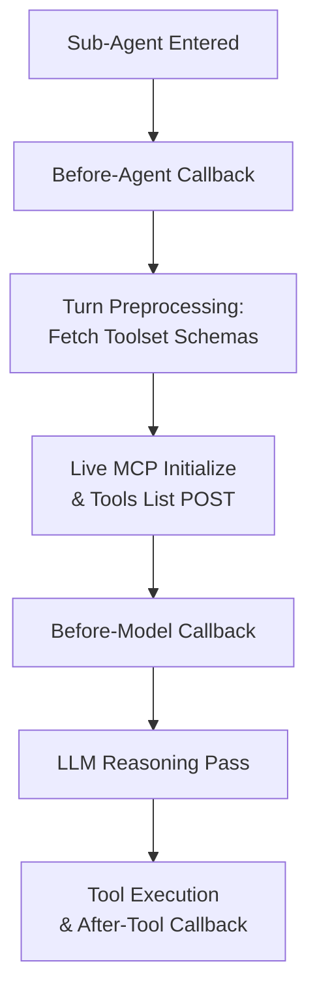
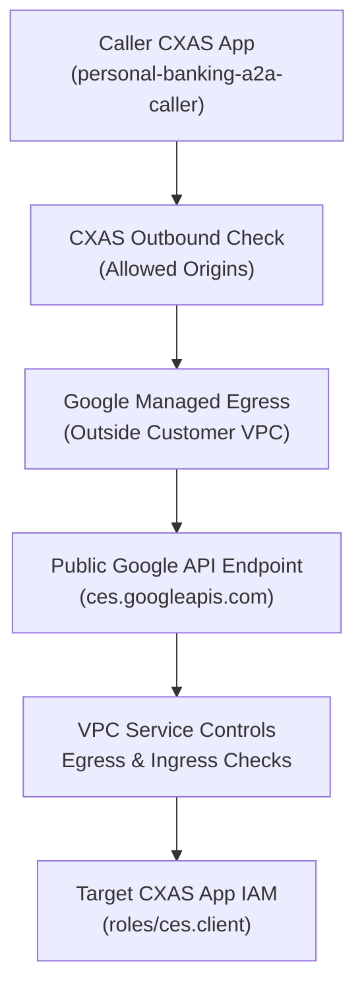

# CX Agent Studio (GECX): MCP Error Handling, Regional Failover & A2A Protocol Guide

> [!NOTE]
> This technical guide explains how CX Agent Studio (GECX) initializes Model Context Protocol (MCP) toolsets, how to intercept MCP connectivity errors and design regional failover across Service Directory endpoints, and how to configure VPC Service Controls (VPC-SC) and IAM for Agent-to-Agent (A2A) communication.

## 1. Executive Summary

Teams building voice and chat agents on CX Agent Studio (GECX) commonly encounter two integration questions when moving to private enterprise networks and multi-agent topologies:

1. **MCP Toolset Initialization and Regional Resilience:** When an MCP toolset is attached directly to a sub-agent, CXAS initializes an MCP session and fetches tool schemas during turn preprocessing before any model callbacks or tool logic run. If the upstream proxy or MCP endpoint fails or rejects the handshake, the turn terminates immediately with an unhandled precondition error. By omitting the MCP toolset from the sub-agent's `toolsets` array, pinning tool schema snapshots where supported, and invoking the MCP toolset from a Python Function Tool controller, teams eliminate entry-time network calls and capture all transport or protocol errors in Python for regional failover or graceful degradation.
2. **A2A Protocol Connectivity Under VPC Service Controls:** Outbound A2A calls from one CXAS application to another CXAS application travel over HTTPS from Google's managed CXAS runtime environment to the public Google API endpoint (`ces.googleapis.com`) rather than through a customer VPC Service Directory. Even when both CXAS applications and the calling service account reside in the same GCP project and perimeter, VPC Service Controls logs an egress violation (`RESOURCES_NOT_IN_SAME_SERVICE_PERIMETER`) on `A2AService.SendMessage` because no target project container is populated on the policy check, requiring a perimeter egress rule (`resources: ["*"]` on `ces.googleapis.com`), a companion ingress rule, and `https://ces.googleapis.com` in CXAS `allowedOrigins`.

---

## 2. Scenario 1: MCP Session Initialization, Error Handling & Regional Failover

### 2.1 Diagnosing the HTTP 400 Precondition Error

When entering a sub-agent configured with an MCP toolset, the CXAS Console Simulator or `runSession` API may return an error payload similar to the following:

```json
{
  "code": 400,
  "message": "Failed to initialize MCP session for customer_idv (URL: https://apigee-proxy.internal.example/v1/mcp-proxy/idv-server/mcp1): MCP server endpoint returned HTTP status code 400 (Bad Request)",
  "status": "FAILED_PRECONDITION"
}
```

Two diagnostic conclusions follow directly from this error structure:

* When CXAS initializes an MCP session during sub-agent entry to discover tools, the error message names the toolset display name directly (`for customer_idv`). When an error occurs later during an actual tool call, the message prefixes the identifier with the word `tool` (`for tool verify_customer`). This confirms the error occurred during sub-agent entry discovery rather than tool execution.
* An HTTP 400 status code from the MCP server endpoint indicates that Service Directory resolution, private network routing, and the TLS handshake all completed, and that the Apigee proxy or downstream MCP server actively rejected the JSON-RPC initialization POST request. Before testing regional failover, inspect the Apigee proxy trace for rejected headers, path mismatches, or required content negotiation headers.

### 2.2 Why MCP Initialization Runs Before Callbacks

When an MCP toolset is listed directly on an agent resource, the CXAS runtime resolves the tool schemas before invoking the language model so that function declarations can be included in the model request:



In session turns, the before-agent callback runs first, followed immediately by turn preprocessing. During preprocessing, CXAS checks its short-lived runtime toolset schema cache (which is bypassed in the Console Simulator and refreshed on cache expiry) and opens a live Streamable HTTP session to the MCP server with a short initialization timeout. Only after the MCP server responds to the initialization and tool-listing calls does CXAS invoke the before-model callback and the language model.

Because turn preprocessing occurs outside the tool execution wrapper, no try/catch block or callback hook intercepts an initialization failure when the toolset is attached directly to the sub-agent without schema snapshots.

### 2.3 Comparing MCP Integration Patterns

Detaching the MCP toolsets from the sub-agent's `toolsets` list and invoking them through a Python Function Tool controller shifts all MCP network activity into a protected execution boundary where errors can be caught and handled deterministically.

| Integration Pattern | Network Call on Sub-Agent Entry | Runtime Error Behavior |
| :--- | :--- | :--- |
| **1. Direct MCP toolset on sub-agent (no snapshots)** | Sends live MCP initialization and tool-list requests on cache miss (and on every Console Simulator turn). | Unhandled 400 precondition error aborts the conversation turn before callbacks run. |
| **2. Direct MCP toolset on sub-agent with pinned snapshots** | Skips MCP initialization on entry when snapshots are populated. | MCP call-time errors return a structured error dictionary to the model, but Service Directory or VPC-SC errors can still surface outside Python and abort the turn. |
| **3. Recommended: Python controller wrapper (MCP toolsets omitted from sub-agent) + pinned snapshots** | Zero Service Directory or MCP network calls on session start or sub-agent entry; also skips redundant tool-list calls during execution when snapshots are present. | Every failure mode (Service Directory, VPC-SC, HTTP 4xx/5xx, and timeouts) is caught and returned to Python as an inspectable response object. |

### 2.4 Implementing Interception and Failover in Python

To prevent entry-time crashes and handle regional endpoint failures in Python, apply two configuration steps.

First, omit the MCP toolsets from the sub-agent's `toolsets` array (so the model only sees your Python Function Tool controller) and pin tool schema snapshots on the MCP toolset resource (see [`customer_idv_primary.json`](../../cxas_app/Albion_Bank_MCP_Failover/toolsets/customer_idv_primary/customer_idv_primary.json) and [`customer_idv_secondary.json`](../../cxas_app/Albion_Bank_MCP_Failover/toolsets/customer_idv_secondary/customer_idv_secondary.json) in the `cxas-scrapi` bundle):

```json
{
  "name": "customer_idv_primary",
  "displayName": "customer_idv_primary",
  "mcpToolset": {
    "serverAddress": "https://apigee-euwe2.internal.example/v1/mcp-proxy/idv-server/mcp1",
    "serviceDirectoryConfig": {
      "service": "projects/albion-gcp-project/locations/europe-west2/namespaces/mcp/services/apigee-ilb"
    },
    "toolOverrides": [
      {
        "tool": "verify_customer",
        "snapshot": {
          "description": "Verifies customer identity status.",
          "inputSchema": {
            "type": "OBJECT",
            "required": ["customer_id"],
            "properties": {
              "customer_id": {
                "type": "STRING",
                "description": "Customer identifier."
              }
            }
          }
        }
      }
    ]
  }
}
```

> [!TIP]
> In the public CXAS v1beta REST reference (`McpToolOverride`), `snapshot` is marked `Output only` and is populated when pinning tool schemas in the CXAS Console. Because the MCP toolsets are omitted from `sub_agent.toolsets[]` and called exclusively from Python, sub-agent entry never triggers an unhandled `initialize` call regardless of whether `snapshot` is populated via REST.

Second, invoke the MCP operation inside your Python Function Tool controller ([`cxas_app/Albion_Bank_MCP_Failover/tools/verify_customer_identity/python_function/python_code.py`](../../cxas_app/Albion_Bank_MCP_Failover/tools/verify_customer_identity/python_function/python_code.py)). When called from Python, CXAS returns two observable response shapes depending on whether the failure occurred during session/transport setup or as a call-time MCP error envelope:

| Observed Python Response Shape | `resp.status_code` | `resp.ok` | `resp.text` / `resp.json()` |
| :--- | :--- | :--- | :--- |
| **Shape 1: Transport, Service Directory, VPC-SC, or unpinned initialization error** | `400` or higher (`400`, `403`, `503`, `504`) | `False` | Empty text string (`""`). |
| **Shape 2: Call-time MCP protocol error envelope** | `0` | `True` (`0 < 400`) | JSON object containing `{"status": "error", "error": "..."}`. |

Checking both conditions in your Python helper guarantees that all failures are intercepted cleanly:

```python
def _is_mcp_call_successful(resp: Any) -> bool:
    """Checks both HTTP transport status and call-time MCP error envelopes."""
    if not resp.ok:
        return False
    if not resp.text:
        return False
    body = resp.json()
    if body.get("status") == "error":
        return False
    return True
```

### 2.5 Architectural Placement of Regional Failover

As documented in the [CX Agent Studio Outbound Networking Patterns guide](https://cloud.google.com/gemini-enterprise-cx/cx-agent-studio/network/outbound#outbound-networking-patterns), Google Cloud recommends routing outbound private connectivity through a Service Directory entry backed by an Internal Application Load Balancer (ALB). Furthermore, because sequential application-level retries across unreachable regional endpoints incur initialization timeouts before the secondary call begins, combining network-level load balancing with application-level error handling provides the lowest latency:

1. **Primary Regional Failover (Network & Load Balancer Layer):** Point your Service Directory service to a Regional or Cross-Region Internal Application Load Balancer with active health checks and outlier detection across regional Apigee backend groups. If an Apigee instance or regional MCP backend becomes unhealthy, the load balancer shifts traffic automatically in sub-second time without consuming CXAS tool timeout budgets.
2. **Application Defense-in-Depth (Python Controller Wrapper):** Detach the MCP toolsets from the sub-agent configuration and invoke the MCP operations inside a Python controller tool. This ensures that even a complete proxy rejection or Service Directory outage is caught in Python and handled via a secondary endpoint or a graceful customer fallback.

---

## 3. Scenario 2: A2A Connectivity & VPC Service Controls

### 3.1 Outbound Network and API Path for A2A Calls

When a steering or personal banking CXAS application invokes a remote CXAS application (such as a mortgage specialist agent) using a native A2A tool, the request follows a different network path from OpenAPI and MCP toolsets:



Three architectural rules govern this path:

* Native A2A tool definitions do not expose a Service Directory configuration field, so outbound A2A requests do not route through a customer VPC.
* The calling CXAS agent issues an HTTPS POST request to the target application's A2A endpoint on the public Google API domain (`ces.googleapis.com`, method `lf.a2a.v1.A2AService.SendMessage`).
* As recorded in VPC Service Controls policy audit logs (`cloudaudit.googleapis.com/policy`), `lf.a2a.v1.A2AService.SendMessage` is evaluated from the calling Service Account's project container (`source: projects/123456789012`) with no target project resource container populated on the policy check. Even when both CXAS applications and the calling Service Account reside in the same GCP project and service perimeter, VPC Service Controls logs an egress violation (`RESOURCES_NOT_IN_SAME_SERVICE_PERIMETER`) unless an explicit egress rule permits the calling Service Account to invoke `ces.googleapis.com` across `resources: ["*"]`.

### 3.2 Inspecting the VPC-SC Violation in Cloud Audit Logs

You can inspect the exact service account principal and violation reason (`RESOURCES_NOT_IN_SAME_SERVICE_PERIMETER` under `egressViolations`) by querying the policy audit log stream in your project. Note that while the HTTP error body labels the identifier `vpcServiceControlsUniqueIdentifier`, Cloud Audit Logs index the field as `vpcServiceControlsUniqueId`:

```bash
gcloud logging read \
  'logName="projects/albion-gcp-project/logs/cloudaudit.googleapis.com%2Fpolicy" AND protoPayload.metadata.vpcServiceControlsUniqueId="YOUR_VPCSC_UNIQUE_ID"' \
  --project=albion-gcp-project \
  --format=json
```

In the returned log entry, inspect `protoPayload.authenticationInfo.principalEmail` (to confirm which service account identity authenticated the call) and `protoPayload.metadata.egressViolations` (which records `source: "projects/123456789012"` and `violationReason: "RESOURCES_NOT_IN_SAME_SERVICE_PERIMETER"` on `lf.a2a.v1.A2AService.SendMessage`).

### 3.3 Required VPC-SC, IAM, and CXAS Configuration

Resolving the permission denied error requires aligning three layers: the calling service account identity, the VPC-SC perimeter egress and ingress policies, and the CXAS outbound endpoint control list.

#### Step 1: Verify Which Service Account Identity Is Sent

A common configuration mismatch occurs when a custom service account is attached to the A2A tool while the CXAS client role or VPC-SC rule is granted only to the default CXAS service agent. Check the authentication block on your A2A tool configuration against the table below:

| A2A Tool Auth Configuration | Outbound Token Sent by CXAS | Identity Evaluated by VPC-SC & IAM |
| :--- | :--- | :--- |
| **Omitted (Default)** | OAuth 2.0 access token for the project's default CXAS service agent. | `service-<PROJECT_NUMBER>@gcp-sa-ces.iam.gserviceaccount.com` |
| **Custom Service Account (`serviceAccountAuthConfig`)** | OAuth 2.0 access token for the configured custom service account. | `<custom-sa>@<project-id>.iam.gserviceaccount.com` (the default CXAS service agent must hold `roles/iam.serviceAccountTokenCreator` on this custom SA, and this custom SA must be listed in the VPC-SC rules and hold `roles/ces.client`). |
| **Empty `apiAuthentication: {}` or `serviceAgentIdTokenAuthConfig`** | OIDC ID token (intended for Cloud Run or Apigee, rejected by `*.googleapis.com` with HTTP 401). | Do not use for `ces.googleapis.com` endpoints. |

Once VPC Service Controls permits the request, the target CXAS application checks the `roles/ces.client` role against the exact identity shown in the table above. If VPC Service Controls passes but `roles/ces.client` is missing on that service account, the error changes from a `VPC_SERVICE_CONTROLS` violation to an IAM error (`403 PERMISSION_DENIED: The caller does not have permission`).

#### Step 2: Add VPC-SC Egress and Ingress Rules on the Service Perimeter

Because `lf.a2a.v1.A2AService.SendMessage` is logged in VPC-SC policy audit logs with `source: projects/123456789012` and no target project container, VPC Service Controls checks egress from the calling service account's project against an empty target resource, which only matches an egress rule with `resources: ["*"]` (scoping `egressTo.resources` to `projects/123456789012` will not match). Add the egress rule ([`vpcsc_policies/egress_a2a_cxas.yaml`](../../vpcsc_policies/egress_a2a_cxas.yaml)) and companion ingress rule ([`vpcsc_policies/ingress_a2a_cxas.yaml`](../../vpcsc_policies/ingress_a2a_cxas.yaml)) to the service perimeter protecting the project:

```yaml
# vpcsc_policies/egress_a2a_cxas.yaml
- egressFrom:
    identities:
      - serviceAccount:service-123456789012@gcp-sa-ces.iam.gserviceaccount.com
      - serviceAccount:a2a-custom-caller@albion-gcp-project.iam.gserviceaccount.com
  egressTo:
    operations:
      - serviceName: ces.googleapis.com
        methodSelectors:
          - method: "*"
    resources:
      - "*"
```

```yaml
# vpcsc_policies/ingress_a2a_cxas.yaml
- ingressFrom:
    identities:
      - serviceAccount:service-123456789012@gcp-sa-ces.iam.gserviceaccount.com
      - serviceAccount:a2a-custom-caller@albion-gcp-project.iam.gserviceaccount.com
    sources:
      - accessLevel: "*"
  ingressTo:
    resources:
      - projects/123456789012
    operations:
      - serviceName: ces.googleapis.com
        methodSelectors:
          - method: "*"
```

Also ensure that Contact Center AI Insights (`contactcenterinsights.googleapis.com`) is included alongside `ces.googleapis.com` in the perimeter's restricted services list, as required by VPC Service Controls for CX Agent Studio.

#### Step 3: Verify CXAS Outbound Allowed Origins

When a project is protected by an enforced VPC-SC perimeter, CXAS outbound endpoint control defaults to `VPCSC_ONLY` and blocks any non-Service-Directory HTTPS call whose origin is not explicitly allowlisted. Add `https://ces.googleapis.com` (exact origin without a trailing slash) to the allowed origins list in CXAS security settings (`projects/albion-gcp-project/locations/eu/securitySettings`), and allow several minutes for updated security settings to propagate across the runtime.

#### Step 4: Consider In-Process Sub-Agents for Same-Project Domains

If the Personal Banking and Mortgage Specialist agents reside in the same GCP project and do not require independent application release lifecycles, consider modeling them as native sub-agents or agent-as-a-tool delegates within a single CXAS application. In-process sub-agent delegation executes entirely inside the CXAS runtime with zero external HTTP hops, requires no VPC-SC perimeter rules, reduces turn latency, and preserves native bidirectional voice streaming across agent handoffs (whereas A2A tool calls exchange text payloads).
