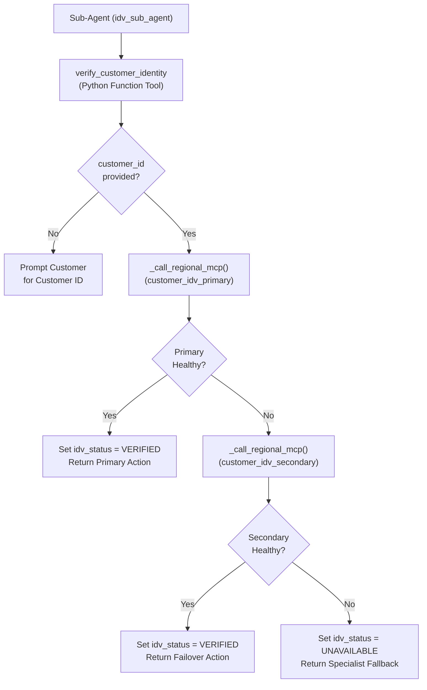

# Python Function Tools Catalog

This directory documents the CX Agent Studio (GECX) Python Function Tool controllers included in this repository under [`cxas_app/`](../../cxas_app/).

## Why Use a Python Controller Tool Around MCP Toolsets?

In CX Agent Studio (GECX), exposing an MCP toolset directly on a sub-agent (`toolsets[]`) causes the runtime to execute a live MCP session initialization and schema discovery handshake during turn preprocessing before any callbacks run. Instead, we expose a single Python Function Tool controller (`verify_customer_identity`) to the model, omit the underlying MCP toolsets (`customer_idv_primary` and `customer_idv_secondary`) from `sub_agent.toolsets[]`, and invoke the MCP operations inside Python where transport and protocol failures can be intercepted cleanly.

---

## Tool Index

| Tool / Helper Name | Source File & Line Range | Spec Doc | Description |
| :--- | :--- | :--- | :--- |
| **[`verify_customer_identity`](../../cxas_app/Albion_Bank_MCP_Failover/tools/verify_customer_identity/python_function/python_code.py#L11-L71)** | [`cxas_app/Albion_Bank_MCP_Failover/tools/verify_customer_identity/python_function/python_code.py` (L11–L71)](../../cxas_app/Albion_Bank_MCP_Failover/tools/verify_customer_identity/python_function/python_code.py#L11-L71) | [`verify_customer_identity.md`](verify_customer_identity.md) | Top-level dispatcher that validates `customer_id`, attempts primary MCP verification, fails over to secondary MCP verification, and degrades gracefully on total outage. |
| **[`_call_regional_mcp`](../../cxas_app/Albion_Bank_MCP_Failover/tools/verify_customer_identity/python_function/python_code.py#L74-L82)** | [`cxas_app/Albion_Bank_MCP_Failover/tools/verify_customer_identity/python_function/python_code.py` (L74–L82)](../../cxas_app/Albion_Bank_MCP_Failover/tools/verify_customer_identity/python_function/python_code.py#L74-L82) | [`verify_customer_identity.md`](verify_customer_identity.md) | Invokes a regional MCP tool function (`customer_idv_primary_verify_customer` or `customer_idv_secondary_verify_customer`) and returns the verified record or `None`. |
| **[`_is_mcp_call_successful`](../../cxas_app/Albion_Bank_MCP_Failover/tools/verify_customer_identity/python_function/python_code.py#L85-L94)** | [`cxas_app/Albion_Bank_MCP_Failover/tools/verify_customer_identity/python_function/python_code.py` (L85–L94)](../../cxas_app/Albion_Bank_MCP_Failover/tools/verify_customer_identity/python_function/python_code.py#L85-L94) | [`verify_customer_identity.md`](verify_customer_identity.md) | Checks both HTTP transport status (`resp.ok`) and call-time MCP error envelopes (`body.get("status") == "error"`). |
| **[`_extract_verification_record`](../../cxas_app/Albion_Bank_MCP_Failover/tools/verify_customer_identity/python_function/python_code.py#L97-L103)** | [`cxas_app/Albion_Bank_MCP_Failover/tools/verify_customer_identity/python_function/python_code.py` (L97–L103)](../../cxas_app/Albion_Bank_MCP_Failover/tools/verify_customer_identity/python_function/python_code.py#L97-L103) | [`verify_customer_identity.md`](verify_customer_identity.md) | Unwraps the FastMCP `text_output` dictionary envelope returned by the CXAS runtime. |
| **[`_format_verified_action`](../../cxas_app/Albion_Bank_MCP_Failover/tools/verify_customer_identity/python_function/python_code.py#L106-L119)** | [`cxas_app/Albion_Bank_MCP_Failover/tools/verify_customer_identity/python_function/python_code.py` (L106–L119)](../../cxas_app/Albion_Bank_MCP_Failover/tools/verify_customer_identity/python_function/python_code.py#L106-L119) | [`verify_customer_identity.md`](verify_customer_identity.md) | Formats the single-key `{"agent_action": ...}` instruction returned to the language model. |
| **[`route_to_idv`](../../cxas_app/Albion_Bank_MCP_Failover/tools/route_to_idv/python_function/python_code.py#L11-L56)** | [`cxas_app/Albion_Bank_MCP_Failover/tools/route_to_idv/python_function/python_code.py` (L11–L56)](../../cxas_app/Albion_Bank_MCP_Failover/tools/route_to_idv/python_function/python_code.py#L11-L56) | [`../../cxas_app/README.md`](../../cxas_app/README.md) | Steering controller tool that stages `context.state["target_agent"] = "idv_sub_agent"` for silent `before_model_callback` routing or escalates human specialist requests. |
| **[`lookup_mortgage_rates`](../../cxas_app/Albion_Bank_Mortgage_Specialist_A2A_Target/tools/lookup_mortgage_rates/python_function/python_code.py#L17-L44)** | [`cxas_app/Albion_Bank_Mortgage_Specialist_A2A_Target/tools/lookup_mortgage_rates/python_function/python_code.py` (L17–L44)](../../cxas_app/Albion_Bank_Mortgage_Specialist_A2A_Target/tools/lookup_mortgage_rates/python_function/python_code.py#L17-L44) | [`../../cxas_app/README.md`](../../cxas_app/README.md) | Mortgage Specialist controller tool returning Albion Bank 2-year (`4.45%`) and 5-year (`4.15%`) fixed mortgage rates and the `10%` annual penalty-free overpayment allowance. |
