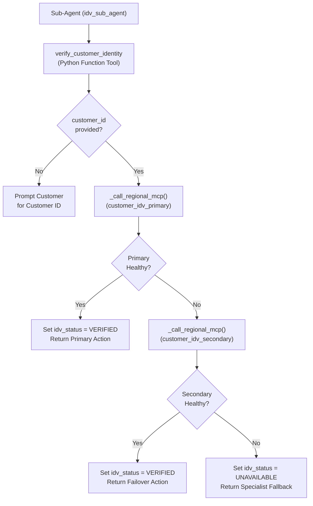

# Python Function Tools Catalog

This directory documents the CX Agent Studio (GECX) Python Function Tool controllers included in this repository.

## Why Use a Python Controller Tool Around MCP Toolsets?

In CX Agent Studio (GECX), exposing an MCP toolset directly on a sub-agent (`toolsets[]`) causes the runtime to execute a live MCP session initialization and schema discovery handshake during turn preprocessing before any callbacks run. Instead, we expose a single Python Function Tool controller (`verify_customer_identity`) to the model, omit the underlying MCP toolsets (`customer_idv_primary` and `customer_idv_secondary`) from `sub_agent.toolsets[]`, and invoke the MCP operations inside Python where transport and protocol failures can be intercepted cleanly.

---

## Tool Index

| Tool Name | Source File & Line Range | Spec Doc | Description |
| :--- | :--- | :--- | :--- |
| **[`verify_customer_identity`](../../tools/verify_customer_identity/python_function/python_code.py#L8-L63)** | [`tools/verify_customer_identity/python_function/python_code.py` (L8–L63)](../../tools/verify_customer_identity/python_function/python_code.py#L8-L63) | [`verify_customer_identity.md`](verify_customer_identity.md) | Top-level dispatcher that validates `customer_id`, attempts primary MCP verification, fails over to secondary MCP verification, and degrades gracefully on total outage. |
| **[`_call_regional_mcp`](../../tools/verify_customer_identity/python_function/python_code.py#L66-L74)** | [`tools/verify_customer_identity/python_function/python_code.py` (L66–L74)](../../tools/verify_customer_identity/python_function/python_code.py#L66-L74) | [`verify_customer_identity.md`](verify_customer_identity.md) | Invokes a regional MCP tool function (`customer_idv_primary_verify_customer` or `customer_idv_secondary_verify_customer`) and returns the verified record or `None`. |
| **[`_is_mcp_call_successful`](../../tools/verify_customer_identity/python_function/python_code.py#L77-L86)** | [`tools/verify_customer_identity/python_function/python_code.py` (L77–L86)](../../tools/verify_customer_identity/python_function/python_code.py#L77-L86) | [`verify_customer_identity.md`](verify_customer_identity.md) | Checks both HTTP transport status (`resp.ok`) and call-time MCP error envelopes (`body.get("status") == "error"`). |
| **[`_extract_verification_record`](../../tools/verify_customer_identity/python_function/python_code.py#L89-L92)** | [`tools/verify_customer_identity/python_function/python_code.py` (L89–L92)](../../tools/verify_customer_identity/python_function/python_code.py#L89-L92) | [`verify_customer_identity.md`](verify_customer_identity.md) | Unwraps the FastMCP `text_output` dictionary envelope returned by the CXAS runtime. |
| **[`_format_verified_action`](../../tools/verify_customer_identity/python_function/python_code.py#L95-L108)** | [`tools/verify_customer_identity/python_function/python_code.py` (L95–L108)](../../tools/verify_customer_identity/python_function/python_code.py#L95-L108) | [`verify_customer_identity.md`](verify_customer_identity.md) | Formats the single-key `{"agent_action": ...}` instruction returned to the language model. |
