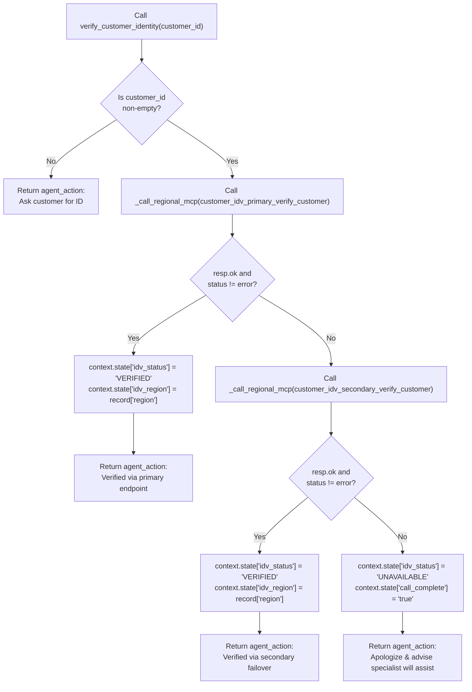

# Tool Specification: `verify_customer_identity`

- **Source Files:** [`tools/verify_customer_identity/python_function/python_code.py`](../../tools/verify_customer_identity/python_function/python_code.py) & [`cxas_app/Albion_Bank_MCP_Failover/tools/verify_customer_identity/python_function/python_code.py`](../../cxas_app/Albion_Bank_MCP_Failover/tools/verify_customer_identity/python_function/python_code.py)
- **Test Suites:** [`tests/test_verify_customer_identity.py`](../../tests/test_verify_customer_identity.py) & [`tests/test_cxas_apps.py`](../../tests/test_cxas_apps.py)

---

## 1. Overview & Design Principles

`verify_customer_identity` is a CX Agent Studio (GECX) Python Function Tool controller that wraps two regional MCP toolsets (`customer_idv_primary` in `europe-west2` and `customer_idv_secondary` in `europe-west1`).

It follows four core design principles:
1. **Zero Entry-Time Network Calls:** By omitting both MCP toolsets from the sub-agent's `toolsets` list and invoking them exclusively from Python, CXAS never sends a live MCP `initialize` or `tools/list` call during turn preprocessing on sub-agent entry.
2. **Two-Stage MCP Error Interception:** Checks both Stage 1 transport/initialization failures (`not resp.ok`) and Stage 2 call-time MCP protocol errors (`body.get("status") == "error"`).
3. **Automatic Regional Failover:** Transparently retries against `customer_idv_secondary` whenever `customer_idv_primary` fails, recording the serving region in `context.state["idv_region"]`.
4. **Single-Key `agent_action` Return Contract:** Always returns `{"agent_action": "<directive>"}` and catches unexpected runtime exceptions so the conversation turn never crashes.

---

## 2. Complete Workflow Flowchart



---

## 3. Tool Signature & Parameters

```python
def verify_customer_identity(customer_id: str = "") -> dict[str, str]:
```

| Parameter | Type | Default | Description |
| :--- | :--- | :--- | :--- |
| `customer_id` | `str` | `""` | The customer identifier spoken or entered by the customer (for example, `CUST-101`). Defaults to `""` so the tool can be invoked before the customer has provided an ID. |

**Return Value:**
- `dict[str, str]`: A single-key dictionary `{"agent_action": "..."}` instructing the model on the exact next conversational step.

---

## 4. Sub-Flow Details & Session State Reads/Writes

### Session State Writes

| State Variable | Values Written | When Written |
| :--- | :--- | :--- |
| `context.state["idv_status"]` | `"VERIFIED"` \| `"UNAVAILABLE"` | Set to `"VERIFIED"` when either primary or secondary MCP verification succeeds; set to `"UNAVAILABLE"` when both endpoints fail. |
| `context.state["idv_region"]` | `"europe-west2-primary"` \| `"europe-west1-secondary"` | Set to the `region` field returned by whichever regional MCP server completed the verification. |
| `context.state["escalation_reason"]` | `"IDV_REGIONS_UNAVAILABLE"` \| `"IDV_SYSTEM_ERROR"` | Set when both regional MCP endpoints fail or an unexpected exception occurs. |
| `context.state["call_complete"]` | `"true"` | Set when both regional MCP endpoints fail so the `release_line` `after_model_callback` appends `Part.from_end_session`. |

### Helper Functions

- **[`_call_regional_mcp(mcp_tool_fn, customer_id)`](../../tools/verify_customer_identity/python_function/python_code.py#L74-L82)**: Invokes the provided regional MCP tool callable (`tools.customer_idv_primary_verify_customer` or `tools.customer_idv_secondary_verify_customer`), validates the response with `_is_mcp_call_successful(resp)`, unwraps the payload via `_extract_verification_record(resp)`, and verifies `"region" in record`.
- **[`_is_mcp_call_successful(resp)`](../../tools/verify_customer_identity/python_function/python_code.py#L85-L94)**: Returns `False` if `not resp.ok`, `not resp.text`, or `resp.json().get("status") == "error"`.
- **[`_extract_verification_record(resp)`](../../tools/verify_customer_identity/python_function/python_code.py#L97-L103)**: Safely extracts the parsed `text_output[0]` dictionary from the CXAS FastMCP response envelope (returning `{}` if `text_output` is absent so `_call_regional_mcp` fails over cleanly).
- **[`_format_verified_action(customer_id, record, failed_over)`](../../tools/verify_customer_identity/python_function/python_code.py#L106-L119)**: Produces the `{"agent_action": ...}` dictionary indicating whether verification completed via the primary regional endpoint or secondary regional failover.
